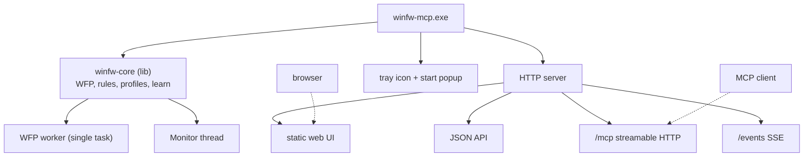

# winfw-mcp

**A portable, web-driven Windows Firewall (WFP) controller with an MCP interface.**

Rewrite of [simplewall](https://github.com/henrypp/simplewall) (C, ~28k LOC) in Rust.
The C implementation is the **functional specification**, not a code base to port line by line.

- Repo: `winfw-mcp` — <https://github.com/prinzalx/winfw-mcp> (public, branch `main`),
  local path `winfw-mcp/`
- Scaffold reference: [`mcp-template`](https://github.com/prinzalx/mcp-template) — a
  template only, **not** a dependency and not vendored here
- Reference sources: `simplewall/` (the C app) and `routine/` (Henry++'s utility library),
  plus `builder/` (upstream packaging only)
- Target platform: **Windows only** — no cross-platform abstraction layer needed
- Language of all code, identifiers, UI strings and docs: **English only**
- Status: **implementing** — M0 to M3 done, M4 (HTTP server + web UI shell) next


---

## 1. Product shape

### What it is

A **single portable executable**. No service, no installer, no registry dependency.

```
winfw-mcp.exe            <- one binary: core + HTTP server + tray + MCP
```

### Lifecycle

1. User starts `winfw-mcp.exe` (double-click, Startup folder, or scheduled task).
2. A **start popup** confirms it is running and shows the local URL. Then it closes.
3. The process stays alive and shows a **system tray icon** only.
4. Clicking the tray icon **opens the default browser** on the web UI.
5. All functionality lives in the web UI. No native dialogs, no modal windows.
6. Tray context menu: `Open` / `Pause protection` / `Quit`.

### Deliberately *not* doing

- No native GUI toolkit (this is the whole point — 47 % of the C code is UI).
- No Windows service (portable requirement).
- No layered popup-notification windows like simplewall's `notifications.c`.
- No other OSes, no macOS/Linux syscalls to emulate.


---

## 2. Data & configuration model

**Everything under user AppData**, resolved once at startup:

```
%APPDATA%\winfw-mcp\
    config.toml          <- settings (port, theme, log level, learn mode, ...)
    rules.toml           <- user rules (allow/deny, apps, services)
    profiles\            <- named profiles, one file each
    learn.bin            <- collected "detected" entries (learning mode)
    logs\                <- rotating log files
    export\              <- destination for on-demand exports
```

Rationale: simplewall already uses `FOLDERID_RoamingAppData` (`../routine/src/rapp.c:572`)
and only falls back to the executable directory when "portable" is detected. We skip that
dual mode entirely — always AppData, always one behaviour. (Alternative would be
`%LOCALAPPDATA%`; Roaming chosen so the config follows a user profile, matching simplewall.)

### Load / write semantics

- **All settings are loaded once at startup** into the in-memory core state.
- **Every change made in the web UI is written through to disk immediately**
  (config, rules, profile/policy files). No "Save" button, no dirty state.
- Writes are **atomic**: write to `*.tmp`, then rename. Prevents a half-written file
  after a power loss, which matters because WFP filters are persistent (see §5).
- The web UI does **not** hold state that the backend does not know about.

### Export / Import / Share

Each functional area (Rules, Profiles, Settings, Learn list) offers **Export**:
writes a human-readable file into `export\` for manual backup. This is the safe direction.

- **Export**: always available, per area. No risk.
- **Import**: offered but treated as *secondary*. Import means "replace what you have",
  which is exactly the dangerous case. Rule ordering and filter IDs have to survive it.
  Decision deferred to a later milestone; we start with export-only.
- **Share** (nice-to-have, cheap and high value): a single filter rule encoded as
  **Base64 string** for copy & paste. Solves "send me that rule" without file exchange.
  Should also be an MCP tool (`encode_rule` / `decode_rule`).


---

## 3. Learning mode (replaces popups)

Because we drop native popups, newly seen connections must be **collected** rather than
announced. This becomes a first-class area in the UI, modelled on Pi-hole's live query log:

```
Detected  (newest first, last N ~ 10 visible, full list on scroll)
   C:\path\to\app.exe      142 connections     [Allow]  [Deny]  [Edit]
   C:\other\thing.exe        3 connections     [Allow]  [Deny]  [Edit]
```

Flow:

1. The monitor thread notices a connection whose process path has **no matching rule**.
2. The entry is added / counted up in the **Detected** list (`learn.bin`).
3. User clicks **Allow** or **Deny** → a real rule is created in `rules.toml` **and**
   committed to WFP immediately → the entry leaves the Detected list.
4. Nothing is ever auto-applied in learning mode. It is a queue, not a policy engine.

**Edit is mandatory and always available** — both in Detected and in the existing rules
list. Concrete driver: after allowing, the entry is a literal path like
`C:\a\b\www.bla.com\app.exe`; the user almost always wants to widen it afterwards to
`*.bla.com\app.exe` without re-entering it.


---

## 4. Wildcards

Rule match strings support simple glob placeholders:

| Token | Meaning | Example |
|---|---|---|
| `*` | any sequence of characters | `*.bla.com\*`, `C:\Tools\*\app.exe` |
| `?` | exactly one character | `app?.exe` |

Notes:

- Matching is **case-insensitive** (Windows path convention).
- simplewall's C code does path validation in `_app_isappvalidpath` (`src/*.c`, 10 call
  sites) but has no first-class wildcard abstraction we can reuse. In Rust we implement
  glob matching **once**, in one function, and it becomes the single source of truth for
  the UI, the rule engine and the MCP layer.
- The translation glob → WFP needs care: WFP itself matches on `FWPM_CONDITION_ALE_APP_ID`
  with either an exact path or a security-descriptor binary. A wildcard rule is therefore
  resolved by **us** (enumerate + match), not by the kernel. That is the main behavioural
  risk of this feature and the reason it is called out separately.


---

## 5. WFP integration notes (learned from the C reference)

These are facts from the C code that constrain the Rust design:

- **Engine handle is process-global**, opened once via `FwpmEngineOpen0` with retry logic
  while the BFE service comes up (`src/wfp.c:1-53`, handles `EPT_S_NOT_REGISTERED`).
  → Must live in the long-running core, not per request.
- **Filters are persistent**: `FWPM_FILTER_FLAG_PERSISTENT`, and provider/sublayer are
  persistent too (`src/wfp.c:241`, `:278`, `:762`), all owned by our own provider GUID.
  → **Enforcement survives a closed tray app.** A portable tray app is therefore safe;
    we only lose monitoring/logging while it is not running.
- **API surface is bounded**: 38 distinct `Fwpm*`/`Fwps*` functions, several loaded
  dynamically (`FwpmNetEventSubscribe1`–`4`) to support older OS builds.
- **RPC is only an auth constant** (`RPC_C_AUTHN_DEFAULT`) — no MIDL stubs, no IDL
  code generation. Removes the fiddliest Win32 build step.
- **Concurrency is thread-pool based**, not window-message based: 5 work queues
  (Files 12, Resolver 6, Packets 6, Notification 2, Filters **1**), plus long-running
  threads `FileMonitor` and `ServicesMonitor`. The single-threaded `FiltersQueue` is the
  serialisation point for WFP writes — map it to one dedicated worker task in Rust.
- **Network events** arrive via `FwpmNetEventSubscribe*` callbacks on worker threads
  (`src/log.c:301-324`) → these map directly to a stream (SSE/WebSocket), no window needed.
- **WinRT footprint is tiny**: 83 lines, 3 types (`Package`, `PackageStatus`,
  `PackageManager`) behind a single function `_app_uwp_getpackageinfo` (`src/uwp.cpp`).
  → CppWinRT can be avoided; use `windows`-crate COM directly, or drop UWP package
    display names in v1 and add them back.
- **Elevation**: manifest is `asInvoker` (`src/res/manifest.xml`); simplewall escalates by
  relaunching via a skip-UAC helper. In Rust: run `asInvoker`, and detect write capability
  on first WFP write. If it fails, show a banner in the web UI offering
  "relaunch elevated". Do **not** hard-code `requireAdministrator`, or the portable
  double-click becomes a UAC prompt every time.
- **Measured here (M2): reading the store needs elevation too.** An unelevated process opens the
  engine happily, but every `Fwpm*CreateEnumHandle0` answers `0x00000005` (access denied) — not
  just for providers, for filters as well. So the banner in the web UI is not a write-only
  concern: without elevation there is nothing to show at all. `FwpmEngineOpen0` succeeding is
  therefore not proof of a usable session, and "degraded" must be a state the UI renders.
- **`windows`-crate layout, measured on 0.62.2**: `Fwpm*` lives in
  `Win32::NetworkManagement::WindowsFilteringPlatform` (not in WinSock), and
  `FwpmEngineOpen0` is additionally gated behind `Win32_System_Rpc` because of its credentials
  parameter. The filter structs only implement `Default` when `Win32_Security` is on. Worth
  knowing before the first `cargo add` guesses the wrong feature set.
- **Window-bound leftovers** we must replace when going headless:
  `WM_DEVICECHANGE` / `DBT_DEVICEARRIVAL` for volume changes (`src/main.c:2733`) and
  window-based `_r_sys_settimer`. Both solvable with a message-only window
  (`HWND_MESSAGE`) or a dedicated thread. Small, but real.

### What we do *not* need from `routine`

The C reference depends on 469 distinct `_r_*` helper symbols across ~45k lines of library
code. In Rust almost all of it disappears into std/crates:

| routine area | usage | Rust replacement |
|---|---|---|
| `_r_obj_*` ref counting | 348× deref, 42× ref | `Arc` + `Drop` |
| `_r_queuedlock_*` | 196 calls | `RwLock` / `parking_lot` |
| `_r_str_*`, `_r_list_*` | 38 / 59 symbols | `String`, `Vec` |
| `_r_xml_*` | 22 symbols (own parser!) | `quick-xml` |
| `_r_config_*` | 13 symbols | `serde` + `toml` |
| `_r_workqueue_*` | 5 queues | dedicated worker threads / channels |

> Caveat: `../routine` was cloned from `master` (2025-12-21), which is ~10 months older
> than `../simplewall` (2026-10). 29 helper names simplewall calls no longer exist there
> (e.g. `_r_button_checkradio` → `_r_ctrl_checkradio`, `_r_sys_gettimestamp` →
> `_r_fs_gettimestamp`). Irrelevant for a rewrite, relevant only if we ever build the C
> reference for comparison.


---

## 6. Architecture



Design rules:

- **`winfw-core` is the only place that touches WFP.** It exposes a command/query API.
  HTTP, MCP and (later) any CLI are thin transports over the same core. Adding MCP later
  must not require core changes.
- **Single source of truth**: WFP is the truth for live state, `rules.toml` is the truth
  for user intent. They are reconciled on startup, and the diff is surfaced in the UI.
- **MCP transport**: `streamable HTTP` on the same server. Because the process is a
  resident tray app that owns persistent WFP state, an MCP client must **not** be able to
  terminate it. A thin stdio shim stays possible as a separate binary later.

Suggested crate choices (to confirm at implementation time):

| Concern | Choice | Why |
|---|---|---|
| Win32 / WFP | `windows` **0.62** | official; verified reading the live store (§8) |
| HTTP server | `axum` + `tokio` | SSE support, plays well with MCP |
| Serialization | `serde` + `serde_json` + `toml` | config and API in one model system |
| XML (profile compat) | `quick-xml` | reading existing simplewall profiles |
| Frontend assets | `rust-embed` | keeps the single-binary/portable promise |
| MCP | `rmcp` **3.8.0** | streamable-HTTP transport, verified compiling here (§8) |
| Logging | `tracing` | structured, area-scoped |

Frontend stays **build-step free**: plain HTML/CSS/JS + SSE, embedded into the binary.
That avoids shipping Node and keeps "portable" honest.

### Knowledge taken from `mcp-template`

`mcp-template` is the standing template for our MCP projects. It is **not** a dependency of
`winfw-mcp`, nothing is vendored from it, and this crate does not track its checkout. What
we took from it is knowledge, verified on this machine: `rmcp` 3.8.0 compiles, and an
`rmcp` server built on it answers `initialize` / `tools/list` / `tools/call` over stdio.

Two caveats that came out of that exercise:

- `rmcp` 3.x serves Streamable HTTP through **`transport-streamable-http-server`**, which is
  built on `tower`/`http-body`, **not** on axum. So axum stays our *web UI + JSON API* host
  and we mount `StreamableHttpService` alongside it; `axum` is not an `rmcp` dependency.
- The template's `docs/`, `scripts/` and `skills/` still describe the Node workflow
  (`npm run init`, `smoke-*.mjs`). For `winfw-mcp` we reuse the *structure* (contract doc,
  smoke tests per tool, skill file) rather than the Node scripts themselves.


---

## 7. Proposed milestones

Small, each one independently useful, each one testable without the next.

| # | Milestone | Content | Exit test |
|---|---|---|---|
| 0 | **Toolchain** | Rust installed, hello-world binary builds | `cargo build` produces an `.exe` ✅ done (§8) |
| 1 | **Core skeleton** ✅ | `winfw-core`, config load from `%APPDATA%\winfw-mcp`, atomic writes | binary reads config, logs resolved paths |
| 2 | **WFP read path** ✅ | engine handle, enumerate providers/sublayers/filters, each reported on its own | reports the live store; degrades to a warning when unelevated |
| 3 | **Rules model + write path** ✅ | `rules.toml` ↔ WFP, add/remove/enable/disable, elevated-write check | toggling a rule changes live WFP state *and* the file |
| 4 | **HTTP server + web UI shell** ← next | static assets, Rules area, JSON API | browser shows rules, change in UI is on disk instantly |
| 5 | **Live events via SSE** | `FwpmNetEventSubscribe` → SSE stream | connection log scrolls live in browser |
| 6 | **Learning mode** | Detected list, `learn.bin`, Allow/Deny/Edit, wildcard matching | unknown app appears, Allow creates a rule, entry leaves list |
| 7 | **Tray + start popup** | tray icon, click opens browser, `Quit` | no console window, works from double-click |
| 8 | **Export + Share** | per-area export to `export\`, Base64 rule encode/decode | Base64 string pastes back into a second machine |
| 9 | **MCP endpoint** | `/mcp` with tools for status, list/allow/deny/edit, encode/decode | an MCP client can allow a Detected entry |
| 10 | **Profiles** | named profiles, switch, per-profile files | switching profile changes WFP state |

Milestone 0 is **done** (§8). Milestones 1-3 are the risky core; do them first and keep
4-10 additive.

Each milestone is a release: bump the version, update `README.md`, push, tag. The repo is
meant to stay alive, so there is no big-bang release at the end.


---

## 8. Environment check: can we build Rust here?

**Verified 2026-10-31 on this machine — the answer is yes.**

| Item | Result |
|---|---|
| `rustc` / `cargo` | **1.99.1** ✅ (installed by hand, default toolchain `stable-x86_64-pc-windows-msvc`) |
| Default target | `x86_64-pc-windows-msvc` installed ✅ |
| C linker for the MSVC backend (`link.exe`) | **present** — VS 2022 BuildTools, MSVC 14.44.35207, `Hostx64/x64` ✅ |
| Windows SDK | 10.0.26100.0 with `Lib\um\{x64,x86,arm64}` ✅ |
| crates.io reachable | yes — `cargo add` and a full dependency fetch worked ✅ |
| End-to-end build | `cargo build` in `mcp-template` produced `target\debug\mcp-template.exe` in ~23 s ✅ |
| Runtime smoke test | the `.exe` answered `initialize`, `tools/list` and `tools/call` over stdio ✅ |

**Conclusion:** nothing is missing, and Visual Studio 2026 is **not** required — the VS 2022
BuildTools already provide the linker plus SDK libs that the `msvc` target needs. That is
consistent with dropping the C build entirely.

Two working notes for this shell:

- Zed was started before Rust was installed, so `cargo` is **not in PATH** here. Every
  command needs `export PATH="$HOME/.cargo/bin:$PATH"` first (each terminal call is a fresh
  shell), or must call `~/.cargo/bin/cargo.exe` directly. A restart of Zed fixes it.
- If ARM64 builds are wanted later: `rustup target add aarch64-pc-windows-msvc`. x86_64 is
  the primary target for now.


---

## 9. Risks & open questions

Ordered by how much pain they could cause.

1. **Glob matching vs. WFP semantics (highest).** WFP does not natively glob application
   paths the way we want. Wildcard rules are resolved by us, so a `*.bla.com\*` rule must
   be expanded/evaluated at ALE time. Needs a decision: static expansion at rule-add time
   (simpler, stale if paths change) or a callout/sublayer approach (correct, heavier).
   → Spike this early, before milestone 6.
2. **Elevation model.** Portable + `asInvoker`, and since M2 we know **reads** need admin too,
   not just writes. A portable double-click that silently runs non-elevated therefore shows an
   empty store rather than a wrong one, which is easy to mistake for "no rules". Needs a clear
   banner + "relaunch elevated" affordance, and the decision whether the Startup entry uses a
   scheduled task with "highest privileges" (cleaner than a UAC prompt on every logon).
3. **Persistent filters outliving the app.** Good for enforcement, but a crashed/quit tray
   app leaves "detected" collection stopped while policy still applies. The UI should say
   plainly when the monitor is not running.
4. **Binary-format compatibility.** simplewall's `profile_internal.bin` / `profile.xml`
   formats are what existing users have. Only relevant if we want to *import* from
   simplewall. Since import is deferred (§2), this is not a launch blocker — but the
   formats should be captured as test vectors while the C reference is still handy.
5. **Single HTTP port.** Bind `127.0.0.1` only, and make the port configurable with
   fallback, so a conflict does not kill the tray app.
6. **Concurrency in Rust.** The C model leans on `volatile LONG64` counters for the network
   list statistics (`ITEM_NETWORK` in `src/main.h:437-440`) — effectively data races that
   C tolerates. In Rust these become explicit atomics; getting the lock boundaries right
   around the 196 queued-lock use sites is fiddly but mechanical.
7. **`rmcp` arrives late by design.** Until milestone 9 the crate has no MCP dependency, so
   the `rmcp` feature set in §6 is unconfirmed against our own tree. Re-check it then; do
   not add it early just because the template has it.


---

## 10. MCP access model (milestone 9)

Rough shape, decided 2026-10-31, deliberately minimal.

An agent talking to the MCP endpoint may **read everything** — settings, rules, profiles,
the live WFP inventory, the Detected list. **Writes are gated**, and by default there are
none: the endpoint starts out read-only on the policies.

The gate belongs in the **core**, not in the transport. The same functions serve the browser
and the agent, so a permission check pushed down to the HTTP layer could be walked around by
the MCP layer and vice versa. Concretely this wants one config string:

```toml
# config.toml — how much the MCP endpoint may change
mcp_writes = "none"   # "none" | "rules" | "all"
```

- `none` — read-only. Anything that would mutate a file or the store is rejected with a clear
  error naming the setting.
- `rules` — may add, edit, remove and reorder entries in `rules.toml` and apply them. This is
  the intended everyday setting.
- `all` — may also flip settings and switch profiles.

A per-service × per-target allow-list is the natural refinement once we see what an agent
actually touches; it is explicitly **not** part of the first cut.

### Where this can fail

These are the ways an agent escapes its sandbox, and they apply to the web UI too:

1. **Write races.** The browser user and the agent share one core. Applying is a full rebuild,
   so the last writer wins and an edit made a second earlier can be silently undone. Needs at
   least a cheap "store changed underneath you" check before M9.
2. **Persistent filters outlive the process.** There is no notion of a *temporary* rule yet, so
   an agent's experiment stays in the store after it is gone. A temporary rule (WFP non-
   persistent filter plus a volatile entry in our own state) is the open question.
3. **File versus store.** Both `rules.toml` and WFP are written. Which one is authoritative has
   to be defined before two clients can write; the plan is *file first, then store*, and a load
   always reads the file.
4. **Reads need elevation too.** If the process is not elevated the agent reads an empty store
   and can conclude "no rules exist". Reporting that as *unknown* rather than *empty* is part of
   the same work as the banner in §9.2.

### Open questions for you

- Startup mechanism: Startup folder, or scheduled task with "highest privileges"?
- Roaming vs. Local AppData (plan says Roaming, matching simplewall).
- Should `Quit` in the tray also *remove* winfw's WFP filters, or leave enforcement in place?
- Is the Detected list capped and persisted across restarts, or allowed to grow?
- Do Detected entries expire on a timeout as well as a count cap?
