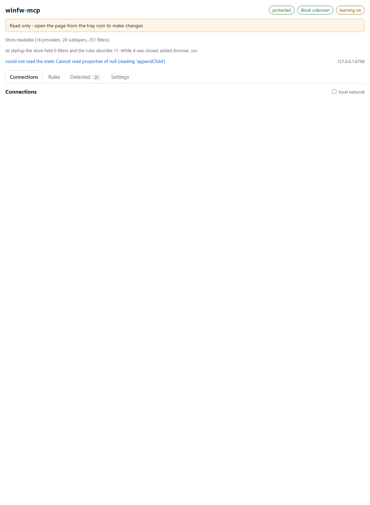
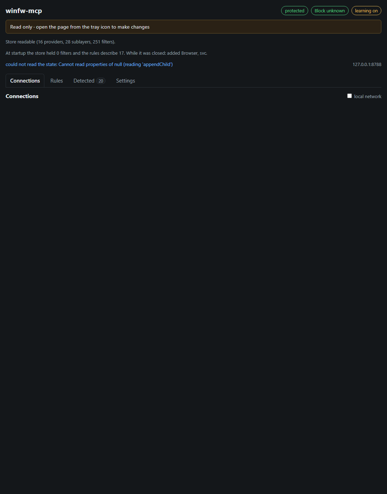
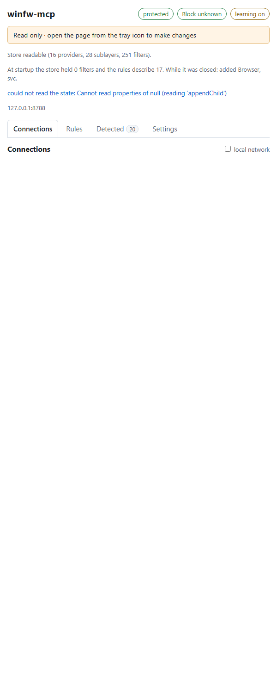
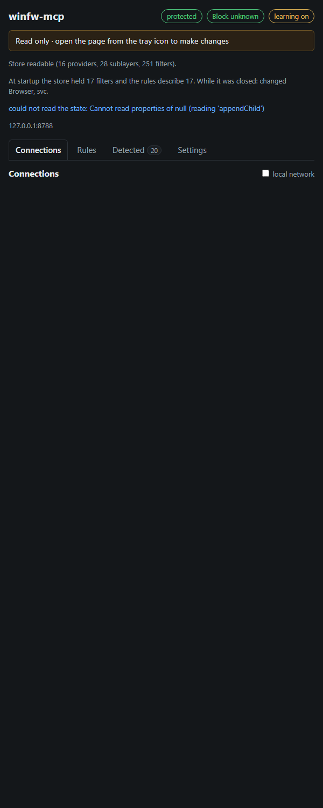

# 5. The web UI

*Part of the [winfw-mcp handbook](../README.md#the-handbook).*

`--serve` binds `127.0.0.1` on the `port` from `config.toml` (8788 by default) and serves a single
page with no build step, embedded in the binary. Open it, edit a rule, and the change is written to
`rules.toml` and pushed to the store immediately.

A port that is already taken does not end the app: the server takes the next free one of the
following eight, warns about it in the log, and the tray icon opens the browser at the port it
actually got.

The page is served from the binary and so is its icon: `GET /favicon.ico` answers with the same
file the tray and the shell use, so a browser tab shows the logo without a single file on disk.

Everything the page needs is in that one file: the style and the script are inline, there is no CDN,
no webfont and no image fetched from outside, which is what makes the page work on a machine whose
network the firewall has just closed. It asks for about 64 KB. Light and dark are the same file; the
choice is made through CSS variables, so nothing is fetched and nothing is rebuilt.

| Light, 1100 px | Dark, 1100 px |
|---|---|
|  |  |

| Light, 600 px | Dark, 600 px |
|---|---|
|  |  |

## What is on the page

The page is one column, at most about 1100 pixels wide and centred. Reading it top to bottom:

- **Header**, one row: the name on the left, three status chips on the right.
  - **protection** reads `on` or `paused` and asks the server to put our filters into the store or
    take them out, which is the pause the [lifecycle chapter](08-lifecycle.md#pausing-protection)
    describes.
  - **policy** is `Block unknown` in green under `deny` and `Allow unknown` in yellow under `allow`.
    It is a chip rather than a word in a settings list because it decides whether an empty rules
    table is a fresh install or a closed firewall. The sentence that explains the exceptions lives
    in the chip's tooltip: under `deny`, loopback and the IPv6 base functions stay reachable; under
    `allow`, programs without a rule go out and only appear in the Detected list.
  - **learning** says whether new applications are collected.
- **Read only band**, shown only on a tab that has no session token: *Read only · open the page from
  the tray icon to make changes*. It is a band rather than a word in the header because a person who
  cannot click anything needs to see why before the first click, not after it.
- **Status line**: what the store reported and the address the page is talking to.
- **Banner**, when there is something the store wants the person to know: a refused store, what the
  rebuild at startup found, or a `rules.toml` that is not the file the tool itself wrote. Details
  under [Banners](#banners).
- **Tabs**: Connections, Rules, Detected, Settings. The Detected tab carries a badge with the number
  of open entries. The state answer carries the whole list — as many entries as the Detected list
  can hold, which is 100 — so a question counted on the badge is never missing from the tab. The
  page opens on Detected when that list holds something, and on Connections when it does not: an
  unanswered question outranks a list of what already happened.

### Connections

The default tab answers *what reached out*. Connections are grouped by program, newest activity on
top, one row per program:

- the file name in large type, the full path under it in small grey drive form (`C:\...`), and the
  account that ran the program under that, as `DOMAIN\name`;
- how many connections of this run the tool has seen for that program;
- a badge for the verdict: **blocked** in red, **allowed** in green, or *by rule &lt;name&gt;* when
  one of our rules decided it;
- **Allow** and **Deny** on the right, which turn the program into a rule at once.

A row expands to the destinations behind it: address and port, the local end, the verdict with the
rule it blamed, and the time, in a monospace table with aligned columns.

The account is what the firewall reported for the connection, resolved from the security identifier
of the event. It is read from the event rather than from the running process, so a program that has
meanwhile exited is still attributed correctly. An identifier that cannot be resolved is shown as its
SID text, and a connection the engine attributed to no user shows no account line at all.

The monitor's own state sits as a small grey line next to the heading:
`running, 128 events, last event 42s ago`, `no feed: 0x00000005`, `starting` or `stopped`. It is the
answer to "is this list empty because nothing happened or because nothing was delivered?", which an
unelevated run can only answer the second way. The age of the newest event answers the harder version
of that question over time: a running feed whose newest event is hours old while the machine is in use
is a subscription that stopped delivering though it stayed open.

A **local network** switch at the right of the list hides connections to a private, link-local or
unique local address. See [Connections worth showing](#connections-worth-showing).

### Rules

A table with fixed column widths: Name, Action, Program, Protocol, Direction, Port, Remote, Comment,
Order, and the remove button. Action is a badge, Order is a pair of arrows, and a pattern the cap cut
carries a small warning badge — *pattern has 42 matches, only 32 installed* — so the cut is visible
where the rule is read rather than only in the log.

A rule is edited in a dialog, not in nine fields that stay on screen: **Add rule** above the table
appends a rule and opens it, and a click on a row opens that one. The dialog holds name, action,
program, protocol, direction, port, remote address, comment and the enabled flag. Protocol is a text
box rather than a list because a rule may name a protocol number such as `47`; the port box takes
`443` or `1024-2048` and the remote box `10.0.0.5`, `192.168.1.0/24` or a span such as
`10.0.0.1-10.0.0.9`, both left empty for anything goes. A value the server cannot read bounces back
as an error and the row is redrawn from what the server has.

An empty table is not an error and says so in a sentence: under `deny` it means every program is
blocked until it appears in the Detected list.

### Detected

One card per application no rule speaks about yet: the file name in large type with the path under it,
the destination it reached, how often it was seen, and four buttons. **Allow** and **Deny** are the two
primary ones and are the widest on the card; **Edit** and **Dismiss** are secondary.

The cards are ordered by the newest activity, and the tab lists every open entry: the answer carries
as many as the Detected list can hold, which is 100. A program that has been running for a week asks
continuously, so ordering the list by first sight would answer its oldest questions and hide the one
it is asking now; a program first seen a minute ago is the more interesting row. The badge on the tab
counts every open entry, so the number on it and the rows below it agree.

**Edit** opens the application path before the rule is written, which is where a path becomes a
pattern: widening `C:\Program Files\Mozilla Firefox\firefox.exe` to
`C:\Program Files\*\firefox.exe` covers the other installs too. **Dismiss** drops the entry without
deciding, and the tool remembers that it was dismissed, so it does not come back.

An entry for a destination a covered application reached is marked `to <address>` and decides that
destination alone.

### Settings

The switches come first, each with a line that says what it does: **Default policy**, **Learning**,
**Protection**, **Theme** (`light -> dark -> auto`, where `auto` follows the operating system) and
**Log level** (`off` through `trace`). All five take effect in the same request and are written to
`config.toml`; the theme is not decoration, it survives a reload, so a bright terminal and a dark
browser stop fighting each other.

**Profile** comes next: the selector switches the live rule file, and `New`, `Rename` and `Delete` sit
beside it. `New` copies the rules on screen into a new profile and switches to it; `Rename` and
`Delete` work on the profile the selector holds, and `Delete` asks first because it takes the rules
file with it. Renaming or deleting the unnamed `default` is refused: it is `rules.toml` itself rather
than a file in `profiles\`.

**Tools** holds the rest: Export, Import, Restore, Apply to WFP, Clear our filters and Quit. Clear and
Quit are set apart from the others and ask before they act, because *Clear* takes the filters out of
the live store and *Quit* ends the process. Restore is the file half of an export: a file chooser takes
a rules file back in, and the interface asks first, because replacing the list is the one action on the
page that can lose rules rather than only fail to add them.

**Help** at the end is a collapsed block. It states the two rules worth knowing without opening the
handbook: a deny always beats an allow whatever the order of the list, and a detected application is
one no rule speaks about yet.

### Banners

The banner is what the store reported. A refused store is shown with its reason rather than as an
empty list. Under it, what the rebuild at startup found: a line naming the filters the store held and
the filters the rules describe, followed by the rules the file gained, flipped or lost while the tool
was closed, shown only when there is a difference to report. An unchanged restart says nothing, and a
refused store needs no second notice because the banner above already names it. A third notice appears
when `rules.toml` on disk is not the file the tool itself wrote: someone edited it, restored a backup
over it, or deleted it, and the rules the page shows are the ones in memory rather than the ones in the
file. Saving a rule makes the file ours again and the notice goes away.

## Connections worth showing

The list answers one question: what reached out. A connection that never left the
machine is not on it at all. That is decided in the monitor rather than in the page, because the
log, the counter next to the heading, the Detected list and everything an MCP client reads are fed
from that one point — and because the log holds two hundred entries, a local agent talking to this
tool's own web server would otherwise crowd the connections a user could act on out of the list.

A destination on the local segment does leave the machine, so it is shown rather than dropped, but
it is marked `local network`: the private ranges, link-local and unique local addresses. The
switch at the head of the list hides exactly those rows, for someone who only wants the Internet. The
filter is presentation only and is not remembered across reloads.

None of this touches the rules. In particular the loopback permits of the default-deny policy are
still installed, which is what keeps the tool reachable while it blocks everything else
([WFP internals](07-wfp-internals.md#the-default-deny-base)).

## Routes

| Route | Purpose |
|---|---|
| `GET /` | the page itself |
| `GET /api/state` | settings, rules, what the store reported, the state of the event feed, what the rebuild at startup found, how often the rules file has been written, whether the process is elevated, whether `rules.toml` changed outside the tool, and the rules whose wildcard pattern the cap cut |
| `POST /api/rules` | replace the rule list: write the file, then rebuild the filters |
| `POST /api/detected` | turn one detected application (or destination, when the entry carries a `remote`) into a rule and rebuild the store |
| `POST /api/settings` | change `learn_mode`, `default_policy`, `theme` or `log_level` at runtime; all four take effect at once |
| `POST /api/detected/dismiss` | drop a detected application or destination without deciding |
| `POST /api/clear` | remove our filters from the store |
| `POST /api/protection` | pause or resume: an empty body flips, `{"enabled":true}` asks for one of the two |
| `POST /api/shutdown` | stop the server, which ends the process; the installed filters stay |
| `POST /api/quit` | take our filters out of the store, then stop the process; the answer reports both apart |
| `POST /api/export` | copy the rules, the config, the Detected list and the profiles into `export\`, and name the active profile in `profile.txt` |
| `POST /api/rules/share` | one rule as a Base64 string, for copy and paste |
| `POST /api/rules/import` | append the rule a Base64 string carries |
| `POST /api/rules/replace` | replace the whole rule list with the text of a rules file: the restore half of an export |
| `POST /api/rules/move` | move one rule to another place in the list: `index` is where it sits, `to` is where it should end up |
| `POST /api/relaunch` | ask the shell for an elevated start of this tool and stop this process; refused while the process is already elevated |
| `GET /api/profiles` | the active profile and the names of the stored profiles |
| `POST /api/profiles/switch` | make another profile live (an empty name selects `rules.toml`) |
| `POST /api/profiles/create` | copy the live rules into a new profile and make it live; a name already taken is refused |
| `POST /api/profiles/rename` | give a profile another name, taking its backup along; the live profile stays live |
| `POST /api/profiles/delete` | remove a profile and its backup, falling back to `rules.toml` when it was the live one |
| `GET /api/events` | the connection feed as a server-sent event stream: the connections that left the machine |
| `GET /api/health` | liveness, for a supervisor or the MCP transport |
| `GET /favicon.ico` | the icon in the browser's tab, served from the binary so a request for it does not answer 404 |
| `POST /mcp` | the Model Context Protocol endpoint (JSON-RPC 2.0) |

## Two pages, one list

A whole-list write — `POST /api/rules`, `POST /api/rules/replace`, `POST /api/rules/move` — may carry
the `generation` its list was read from: the counter every state answer reports, counting how often
this run has written the rules file. A write that names a generation the server has moved past is
answered **409** with the state as it is now, and nothing is written: the page says *the rule list
changed underneath you* and the human decides again. A write that names no generation is
unconditional, which is what a client that knows nothing about the counter sends.

`409` covers the case the fingerprint on the banner cannot: two pages open at the same moment. A
file edited by hand shows up after the fact; a second page writing between this page's read and its
save is caught before it overwrites the first page's edit.

## Who may write

Every request passes a guard before it reaches a route, and the guard distinguishes
reading from writing.

| Check | Applies to | Answer | Why |
|---|---|---|---|
| `Host` names `127.0.0.1`, `localhost` or another loopback address | every route, reads included | **403** | DNS rebinding: a page on another domain can be made to resolve to `127.0.0.1` after it loaded, and then only the `Host` header says which name was used |
| `Origin`, when present, is a loopback origin | writing routes | **403** | the same page on another port is not this page; this is the CSRF case |
| `Content-Type: application/json` | writing routes | **415** | a form or a `text/plain` body is what a cross-site request is allowed to send without asking first |
| `x-winfw-token` equals the token issued at startup | writing routes | **401** | the browser holds the token; a process that never saw it may not write |

The state body does not carry the token: a read is answered to anyone on loopback, and a process that
learned the secret from a body it could read anyway could hand itself a write. The token is sixteen
random bytes rendered as hex, made when the process starts, held in memory only,
and never written to a file or to the log. It reaches the browser in the fragment of the URL the
tray opens (`http://127.0.0.1:8788/#token=…`), a fragment the browser never sends, and the page
takes it out of the address bar again as soon as it has read it. A tab with no fragment — an address
typed by hand, or a reload — reads but cannot write: the write controls are disabled and the header
says *open from the tray icon to make changes* rather than letting the first click answer 401.

`GET`, `HEAD` and `POST /mcp` are exempt from the token, the origin and the content type: a read
cannot change anything, and the MCP endpoint is configured with a URL rather than with a session. The
`Host` check is not exempt, because that is exactly the check a read needs too. What this buys and
what it does not is the subject of [the security model](10-security-model.md).

The page's own responses carry a `Content-Security-Policy` header that allows nothing but this
origin, with inline style and script, because both live in the one embedded file.

A request body the server cannot read answers **400 Bad Request**, and only a
body: a JSON syntax error, a field of the wrong type, a name outside an enum like a theme that is
not `light`, `dark` or `auto`, a field the route does not know. Anything else that can fail — a
store that refused the change, a file that would not write, an index past the end of the rule list
— stays **500**, because then the refusal is about the state and not about what the client sent.

## Export, import, share

Export answers which files it copied and where, which is the manual backup path: every area can be
copied into `export\` on demand. The profiles come along too, into
`export\profiles\` rather than next to `rules.toml`, because a set of equal files is impossible to
tell apart in a flat listing; a profiles directory that is still empty exports nothing and leaves no
directory behind. An export of the rules, the profiles or everything also writes `profile.txt`, a
one-line note naming the profile the rules came from; the unnamed profile is written as `default`,
the same name the page shows. An export of only the config or the Detected list has no profile to
name and writes no such file. Import has two directions. A share string still appends the one
rule it carries rather than replacing anything, so pasting cannot silently discard a rule set. A
whole file replaces the list: `Restore` on the page reads the chosen file in the browser and posts
its text. The MCP endpoint once offered the same thing as `rules.import`, which is gone
like the other writing tools. What comes back is read by the same reader that reads `rules.toml` at
startup, so a version this build does not know, a field name it
does not recognise or a pattern it cannot hold is refused before the file on disk is touched — and
the generation it replaces is kept as the backup either way. The read direction for a single rule is
`POST /api/rules/share`, which answers with the Base64 string alone rather than with JSON; the MCP
endpoint offers the same string as `rules.share`.

## Stopping the page's server

The `Quit` button posts `/api/quit`, which takes our filters out of the store before it ends the
process, so the machine is left as it was found. That ends the process, not merely the request, so
the page reports what happened instead of reloading a server that is no longer there, and it says
whether the store cooperated. A script that wants the other stop — process out, rules in place —
posts `/api/shutdown`. See [lifecycle](08-lifecycle.md#stopping).

---

Previous: [4. Learning mode](04-learning-mode.md) · Next: [6. The MCP endpoint](06-mcp-endpoint.md)
